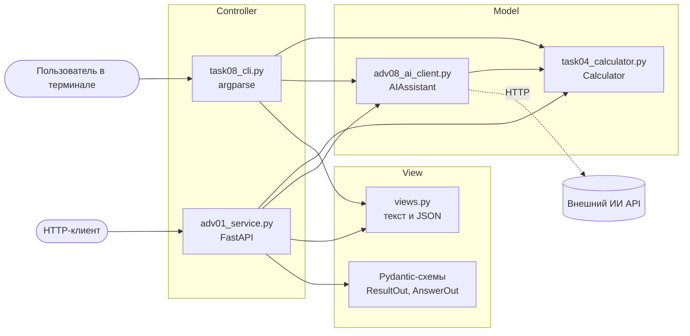
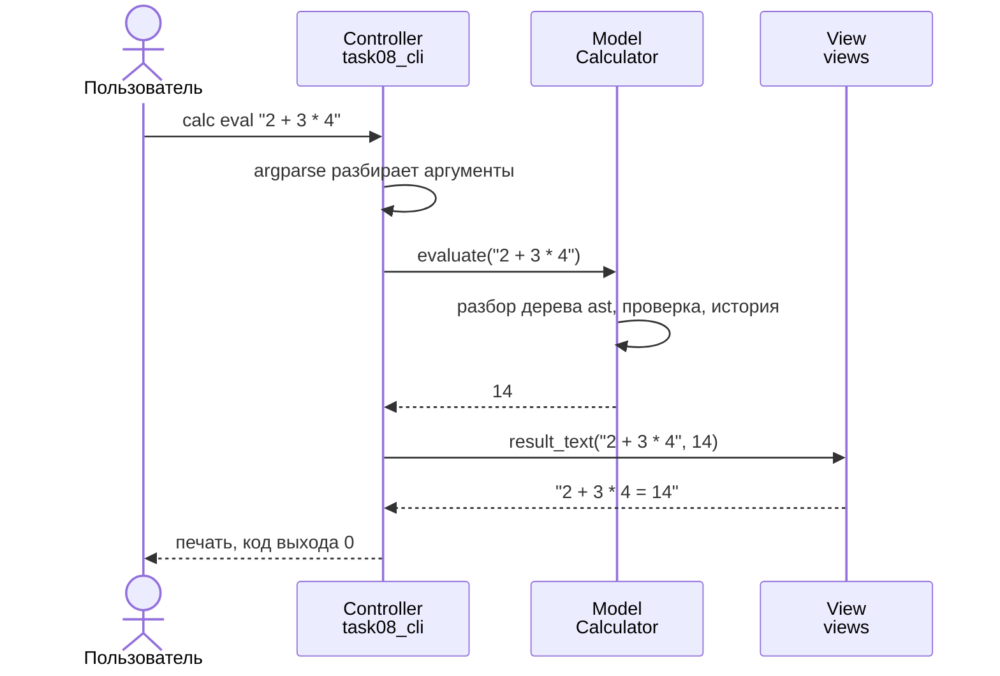
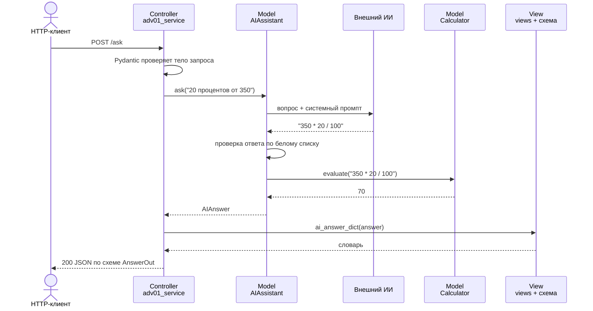

# Архитектура MVC приложения «Калькулятор»

Задание средней сложности №10: описать архитектуру MVC для приложения.
Описывается то самое приложение, которое реализовано в этой лабораторной:
калькулятор с командной строкой, микросервисом и вопросами к ИИ.

## Что такое MVC

**Model–View–Controller** — способ разделить программу на три части
с разной ответственностью:

| Часть | Отвечает за | Не должна знать |
|---|---|---|
| **Model** (модель) | данные и правила предметной области: как считать, что хранить, что считается ошибкой | как данные показываются и откуда пришёл запрос |
| **View** (представление) | как показать результат: текст, JSON, HTML | как результат получен |
| **Controller** (контроллер) | принять ввод, вызвать модель, выбрать представление | как устроены вычисления |

Главная идея: **модель не зависит ни от чего**, остальное зависит от модели.
Поэтому одну модель можно использовать в разных интерфейсах и тестировать
без интерфейса вообще.

## Компоненты приложения

| Роль | Модуль | Содержимое |
|---|---|---|
| Model | `task04_calculator.py` | `Calculator`: операции, безопасный разбор выражений, история, `CalculatorError` |
| Model | `adv08_ai_client.py` | `AIAssistant` и поставщики ИИ: перевод вопроса в выражение, проверка ответа |
| View | `views.py` | `result_text`, `result_dict`, `history_text`, `ai_answer_text`, `to_json`… |
| View | схемы Pydantic в `adv01_service.py` | `ResultOut`, `AnswerOut` — форма JSON-ответа сервиса |
| Controller | `task08_cli.py` | разбор аргументов `argparse`, выбор команды, коды выхода |
| Controller | `adv01_service.py` | маршруты FastAPI, перевод ошибок модели в HTTP-коды |

Стрелки показывают, кто кого вызывает. Модель не вызывает ни контроллеры,
ни представления — у неё нет стрелок «наружу», кроме обращения к внешнему ИИ.

## Как проходит запрос

### Командная строка: `calc eval "2 + 3 * 4"`

### HTTP: `POST /ask {"question": "20 процентов от 350"}`

Ошибки идут тем же путём: модель возбуждает `CalculatorError` или `AIError`,
а контроллер решает, во что их превратить. Командная строка — в сообщение
в stderr и код выхода 1, сервис — в HTTP-коды 400, 502 или 503.
Модель о кодах выхода и HTTP ничего не знает.

## Правила зависимостей

1. **Модель** не импортирует контроллеры, представления, `argparse`, `fastapi`.
2. **Представление** не импортирует модель и контроллеры: оно получает
   готовые данные и только оформляет их.
3. **Контроллер** не содержит вычислений: всё, что сложнее вызова метода
   модели, переносится в модель.

Правила проверяются автоматически тестом `tests/test_architecture.py`:
он читает импорты каждого модуля через `ast` и падает, если правило нарушено.
Так архитектура не размывается со временем — нарушение заметно сразу.

## Что даёт такое разделение

- **Один код вычислений — два интерфейса.** Командная строка и микросервис
  используют один и тот же `Calculator`. Ошибка, исправленная в модели,
  исправлена сразу везде.
- **Тестируемость.** 50+ тестов модели работают без терминала и без сервера.
  Контроллеры тестируются с подменённой моделью (`dependency_overrides`,
  поставщик-заглушка вместо ИИ).
- **Новый интерфейс без правки модели.** Чтобы сделать, например,
  Telegram-бота, нужен только новый контроллер и, возможно, новое
  представление. Модель не меняется.
- **Замена представления.** Флаг `--json` в командной строке переключает
  представление, не трогая ни контроллер, ни модель.

## Где MVC здесь не «по учебнику»

- **Веб-фреймворки сдвигают границы.** В FastAPI превращение объекта в JSON
  делает сам фреймворк по Pydantic-схеме. Поэтому схемы `ResultOut`
  и `AnswerOut` фактически и есть представление сервиса. В Django
  ту же схему называют MTV (Model–Template–View), где «view» играет роль
  контроллера.
- **Классический MVC — про интерфейсы, которые живут долго.** В исходном
  варианте модель сама оповещает представление об изменениях (шаблон
  «Наблюдатель»). У командной строки и HTTP-сервиса каждый запрос
  короткий: запрос → ответ, поэтому оповещения не нужны.
- **ИИ-клиент отнесён к модели**, потому что содержит правила предметной
  области: какой ответ модели допустим и как его проверить. Сетевой запрос
  к внешнему API — это доступ к источнику данных, такой же, как обращение
  к базе данных.

## Сравнение с другими подходами

| Подход | Отличие от MVC |
|---|---|
| **MVP** (Model–View–Presenter) | представление полностью пассивно, вся логика отображения — в Presenter; удобно для тестирования GUI |
| **MVVM** (Model–View–ViewModel) | представление связано с ViewModel через привязку данных; типично для WPF, Vue, SwiftUI |
| **Слоистая архитектура** | слои «представление → сервисы → данные», зависимости только сверху вниз; та же идея разделения, но без жёсткой тройки ролей |

Для этого приложения MVC достаточно: интерфейсы простые, а главная цель —
отделить вычисления от способа общения с пользователем — достигнута.
